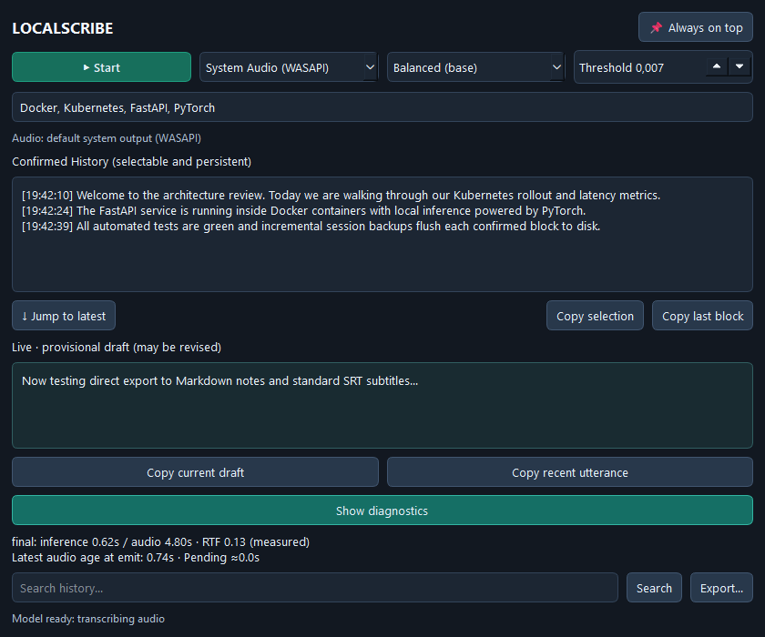

# LocalScribe

**LocalScribe** is a Windows desktop application (Python 3.12 + PySide6) that transcribes live audio **100% locally**, without uploading recordings to the cloud or requiring API keys.

It captures **system audio via WASAPI loopback**, your **microphone**, or **both sources simultaneously**, displaying a provisional live draft while consolidating each confirmed utterance into a persistent, searchable, and exportable transcript history.



---

## Key Features

- **100% Local Processing (CPU & NVIDIA CUDA):** Runs local inference with [`faster-whisper`](https://github.com/SYSTRAN/faster-whisper), supporting switchable model profiles (`tiny`, `base`, `small`, and `large-v3-turbo`), automatic GPU detection with CPU fallback, Silero VAD filtering, and anti-hallucination quality gates.
- **Language Selector & Smart Lock:** Pick a fixed language (`es`, `en`, `pt`, `fr`, `de`, `it`, `ja`, `zh`) or leave on **Auto-detect** (automatically locks the session language once detected with high confidence).
- **Audio Source & Speaker Attribution ("You vs. Them"):** Switch directly from the control bar between:
  - **System Audio (WASAPI):** captures meetings (Zoom, Meet, Teams), lectures, browser audio, or videos.
  - **Microphone:** captures your default Windows microphone.
  - **Both (System + Microphone):** mixes both streams concurrently while tagging each utterance with **`🎙 You`** or **`🔊 Them`** based on active channel energy.
- **Floating Live Captions Overlay (`Ctrl+Shift+O`):** Always-on-top, translucent, draggable subtitle bar that displays live captions over any application, video, or game (scroll wheel adjusts font size).
- **SQLite Session Library with FTS5 Search (`Ctrl+H`):** Every session is automatically indexed in `%APPDATA%\LocalScribe\library.db` with an auto-generated title, timestamp, and entry count. Search across all past meetings in milliseconds from the collapsible sidebar.
- **Drag & Drop Media File Transcription (`Ctrl+O`):** Drop any `.mp3`, `.wav`, `.m4a`, `.mp4`, `.mkv`, `.ogg`, `.flac`, or `.webm` file onto the window (or click **`📂`**) to transcribe pre-recorded lectures, meetings, or voice notes locally.
- **Modern UI 2.0 with Dark & Light Themes:**
  - Animated record button, live input waveform meter, session timer, and collapsible settings drawer (`Ctrl+,`).
  - Confirmed history with **smart scrolling**, floating **`↓ N new`** pill when reading earlier blocks, bookmarks (`★` / `Ctrl+B`), and highlighted search with match counter (`Ctrl+F`).
  - **Keyword Alerts:** Define comma-separated watchwords (e.g., your name, `deadline`, `budget`) to highlight matches and alert the taskbar when mentioned.
- **Custom Vocabulary & Rolling Context:** Combines your domain vocabulary (`initial_prompt`) with the tail of the last confirmed utterance for coherent punctuation and terminology across segments.
- **Multi-Format Export with Sample-Accurate Timestamps:** Export confirmed history to **`.txt`**, **`.md`**, **`.srt`**, **`.vtt`** (WebVTT), or **`.json`** using real sample-counted audio timings.
- **Incremental Session Backup & Per-User Data Folder:** Every confirmed block is immediately synced (`fsync`) to `%APPDATA%\LocalScribe\sessions\session_YYYYMMDD_HHMMSS.txt` (or `LOCALSCRIBE_HOME`).

---

## Requirements

- **Operating System:** Windows 10 or 11 (64-bit).
- **Python:** Python **3.12** (64-bit) with the Windows `py` launcher enabled.
- **Internet Connection (first run only):** Required to install dependencies and download the chosen `faster-whisper` model weights. Once cached, LocalScribe runs completely offline.

---

## Installation

### Recommended (Automated Setup)

1. Clone or download this repository.
2. Run **`INSTALL.bat`** once. It verifies Python 3.12, creates the `.venv` virtual environment, and installs all dependencies from `requirements.txt`.

### Manual Installation (PowerShell)

```powershell
py -3.12 -m venv .venv
.\.venv\Scripts\python.exe -m pip install --upgrade pip
.\.venv\Scripts\python.exe -m pip install -r requirements.txt
```

---

## Usage

Double-click **`START.bat`** or run from PowerShell:

```powershell
.\.venv\Scripts\python.exe main.py
```

1. Choose your **audio source** (*System Audio (WASAPI)*, *Microphone*, or *Both*).
2. Pick a **model profile** (*Fast `tiny`*, *Balanced `base`*, or *Accurate `small`*).
3. Optionally adjust the voice detection **Threshold** and **Optional vocabulary**.
4. Click **▶ Start** to begin live transcription.

---

## Project Structure

```text
LocalScribe/
├── INSTALL.bat              # Automated Windows virtual environment installer
├── START.bat                # Windows application launcher
├── main.py                  # Application entry point
├── requirements.txt         # Runtime dependencies
├── ruff.toml                # Linter and formatter configuration
├── docs/
│   └── screenshot.png       # Application UI screenshot
├── localscribe/
│   ├── __init__.py          # Package metadata and version (v0.5.0)
│   ├── audio.py             # WASAPI loopback, microphone, and dual-stream mixer
│   ├── config.py            # Per-user config.json persistence (%APPDATA%\LocalScribe)
│   ├── pipeline.py          # Adaptive segmenter, Silero VAD, live & file ASR engines
│   ├── session.py           # Thread orchestration and incremental session backups
│   ├── storage.py           # SQLite + FTS5 session library and global search
│   ├── theme.py             # Dark/Light palettes, stylesheet, and generated app icon
│   ├── transcript.py        # Transcript state and .txt/.md/.srt/.vtt/.json exporters
│   ├── ui.py                # PySide6 desktop interface (UI 2.0)
│   └── widgets.py           # SafeTranscript, LevelMeter, and CaptionOverlay
└── tests/
    ├── test_pipeline.py     # Segmentation and recognition queue tests
    ├── test_v02.py          # Concurrency, copy state, and Qt widget regression tests
    ├── test_v03.py          # Config persistence, session backups, export, and audio tests
    └── test_v04.py          # Hallucination filter, language lock, timing, overlay, and UI 2.0 tests
```

---

## Development & Testing

Automated tests run headlessly using Qt's `offscreen` platform without opening real audio devices or downloading models:

```powershell
.\.venv\Scripts\ruff.exe check .
.\.venv\Scripts\ruff.exe format --check .
.\.venv\Scripts\python.exe -m pytest -v
```

---

## Privacy & Responsible Use

All audio processing runs strictly on your machine and is never transmitted to external APIs. Incremental session backups (`sessions/`), diagnostic logs (`logs/`), and local preferences (`config.json`) remain on your device and are excluded from version control via `.gitignore`. Always respect participant consent and institutional policies when transcribing meetings or classes.
